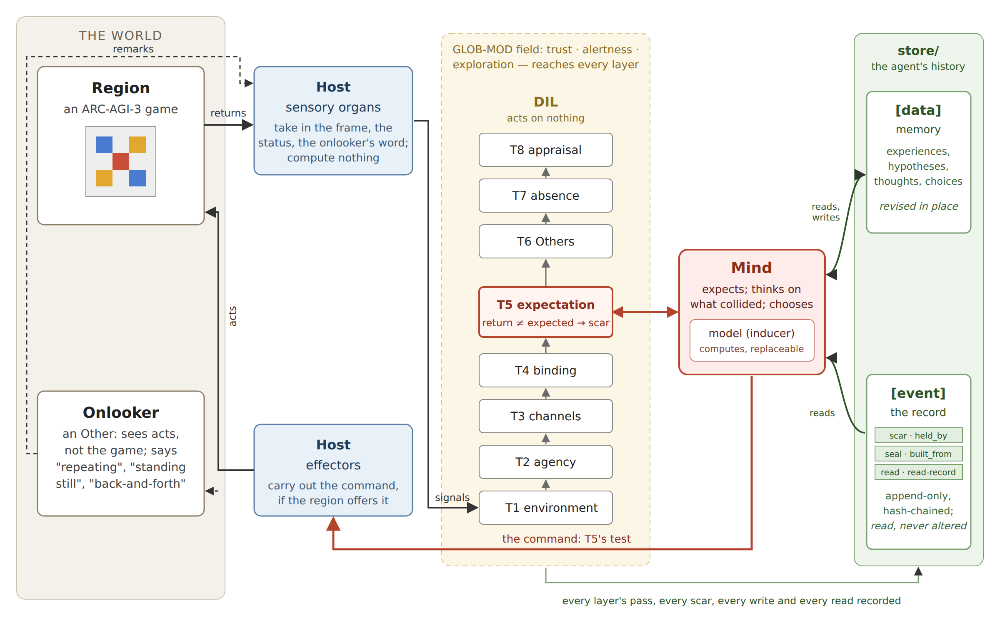
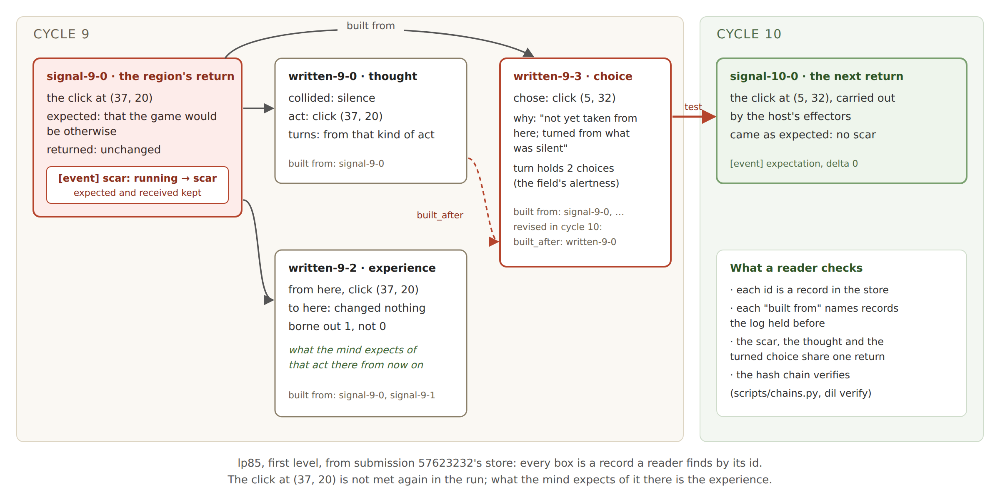

# Expect, Collide, Revise: Learning From Mismatch, Every Step on the Record

*The DIL protocol on ARC-AGI-3 — submission 57623232*

## Abstract

We built an agent that learns each ARC-AGI-3 game from mismatch. It expects what
each action will bring back; where the return differs, the mismatch is recorded
as a collision, and the collision turns what it does next. Every
expectation, collision, thought and choice is a datum naming what it was built
from, in a hash-chained event log, following the DIL protocol. On the 25 public
games, the submitted code's logs hold 1,111 chains a reader can follow from a
collision to the thought and the choice it turned; all 1,735 turned choices are
built from the return that collided, and all 25 logs verify under the protocol's
reference verifier. It also reads its own history; no score moved. The submission
scores 0.25 on the leaderboard, against 0.02 for the starter kit's random agent and
0.06 for the same agent on this submission's road.

## 1. Introduction

ARC-AGI-3 scores an agent by how few actions it needs against a human, on games
it has never seen. The usual way to learn by acting is to maximise a summed reward.
Ours learns from mismatch: the agent expects, the game answers, and where the
answer differs, the difference changes what it does next.

Our question is whether a third party can read back, from the agent's record
alone, what it knew at each step and why it acted. An agent may misread and
revise its memory; it may not rewrite the record of what happened.

Contributions: an agent whose beliefs, refutations and choices are data with
provenance in a hash-chained log; a learning mind that names no task, with a
replaceable model; what the log shows of its play; and a ledger of the ideas that
failed.

*Figure 1: the loop, and the store: memory (`[data]`) and the record (`[event]`).*

## 2. Approach

**DIL** is a protocol for a loop that learns from collision and can be audited:
eight layers (T1–T8), eight invariants that halt the loop when broken, and a store
of two parts — `[data]`, the memory, which may be revised, and `[event]`, an
append-only, hash-chained record. The **host**'s sensory organs take in what the
game returns and its effectors carry out commands; it computes nothing. The
**mind** expects and commands; its **model** computes for it and can be replaced.
The game's return, never the mind, judges a command.

**Learning.** Each step is kept as an experience; what it suggests beyond itself,
the model (a grid inducer) states as a hypothesis, a datum built from that step.
The mind expects by the one right at the highest rate, (right + 1) / (tried + 2),
Laplace's rule of succession; where nothing applies, it expects the game to change,
so silence too can collide. On a mismatch the return and every datum the
expectation rested on move to `scar`; the mind thinks on it, writes the thought,
and the thought turns its next choice — away from an act that changed nothing,
toward where an answer differed, away from what ended the game. A mismatch is never
a penalty: no count of collisions is kept or sought.

**Choosing.** Each kind of act is ranked by counted odds, in order: of the level's
aim, then of reaching a state not met before, plus UCB1's bonus for kinds tried
little (Auer et al. 2002). Nothing is summed or discounted over time. A field of
trust, alertness and exploration, voted by every layer, sets how sure it must be,
how long a turn lasts and how far it looks ahead.

**Its history.** The mind reads `[event]` too: a collision the record says came
before turns it longer, and every read is recorded.

**Prior work.** The choosing rule is count-based exploration (Bellemare et al.
2016). The difference is the mismatch: never a reward, it scars what the
expectation rested on and turns the next choice; there is no value function, and
every datum names its sources.

**An Other.** An onlooker in the world remarks when the agent repeats itself or
stands still; its word reaches the mind as a collision, not an instruction.

## 3. A chain the reader can check

Each cycle leaves in `[event]` every datum's path through the layers, every scar,
every read, and every write with the ids it was built from. Kaggle shows no log of
a scored run; the evidence is the submitted code's Save & Run on the 25 public
games. Its stores are published with the notebook, and at [[link]].

Figure 2 is a chain from lp85, whose first level the agent finished in its human
baseline's 17 actions. A click at (37, 20), expected to change the game, returns it
unchanged: `signal-9-0` is scarred. The thought `written-9-0` turns the mind from
that kind of act; the choice `written-9-3` clicks elsewhere, saying so and naming
the return (and, once its id came back, the thought). The experience `written-9-2`
now holds that the click there changes nothing; the next return, `signal-10-0`,
comes as expected.

Across the 25 games: 2,715 frame collisions; 1,111 chains (a scar, its thought and
the choice it turned, in one cycle, from one return); in 716 the next return came
as expected. A turned choice is any choice a collision shaped — 1,198 in the
collision's cycle (87 chosen again after the onlooker spoke), 495 later while the
turn held, 42 after an end — all 1,735 built from the return that collided. The
mind read the record 3,902 times, each read recorded. All 25 logs verify under the
protocol's reference verifier, and its conformance checker passes §13.1, §13.3,
§13.5 and §13.6 in every store; §13.4 (self) is partial by design, and §13.2
(host) cannot be read from disk.

Individuals of the same agent born in different fields, or with and without the
onlooker, part where a count read of the field differs (the PDF, section 4.2).
`scripts/chains.py`, `thoughts.py` and `differ.py` find all of this in the stores
alone.

*Figure 2: the lp85 chain, each record by its id.*

## 4. Results

| | Leaderboard |
|---|---|
| Random agent (starter kit) | 0.02 |
| The same agent on this submission's road | 0.06 |
| A language model in the learning's place | 0.00 |
| The learning mind, first form | 0.05 |
| Grid inducer, version 12 (scored run ended early, cause unknown) | 0.00 |
| Grid inducer, versions 18, 23, 28, 35, 37, 41 | 0.25–0.26 |
| … with "suspects" (version 26) | 0.02 |
| **This submission (`dil-arc3-history` 1)** | **0.25** |

Scores are RHAE: offline, the toolkit's 0–100 scale; the leaderboard scores the
hidden games. On the 25 public games the submitted code finishes 15 of 183 levels
(0.489). Version 23's log showed where the actions went: 29% changed nothing and
17% walked back to where something was left to try; three levels came near the
human baseline, the rest at 3 to 20 times it. Reading its history changed choices
in six games against version 41 and no score; the notebook ran 20% longer.

## 5. What did not work, and why

Nineteen ideas were measured and not kept (the PDF's Table 3), among them an
object-centred inducer (0.500 against the grid's 0.491, but a level fewer, and
levels count first) and a language model writing predictive programs, right about
one step in eleven.

The lesson is one of Theory. Before its first success in a level, a change only
moves where the agent explores, and the public games did not foretell the hidden
ones: "suspects" set the best public score yet (0.515, its 15 levels equal to the
best) and scored 0.02 hidden, against 0.25 for the version it changed. Since then,
the inducer's laws of things — moves, blocks — apply only once a level's aim has
come, so that what earned the first levels is not moved.

## 6. Limits and conclusion

The score is low, and said so. Where the agent never looks stuck, the onlooker has
no reason to speak, and the checker's failure-signals criterion (§13.7) fails (six
games of 25). What the mind writes returns to the loop as data: naming each
thought in its choice changed choices in nine games of eleven (offline, 1.10603 →
1.10586, levels the same). The verifier is the protocol's own, not independent.

The log diagnoses the agent (29% of actions changed nothing), and the public games
did not predict the hidden ones. What holds is the record: every belief, refutation
and choice the agent made can be read back, and checked, by someone who does not
trust it. The mind names no task; another model has taken its seat, and another
environment is designed to.
